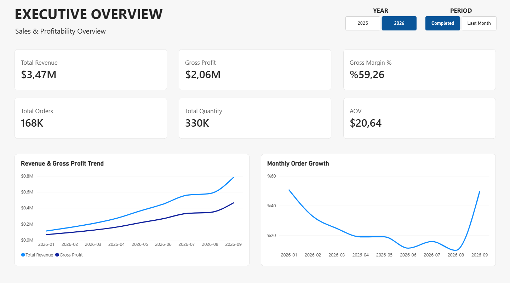
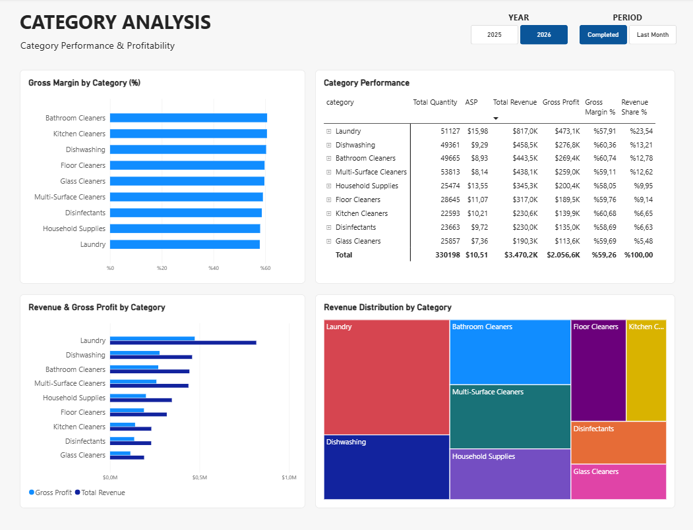
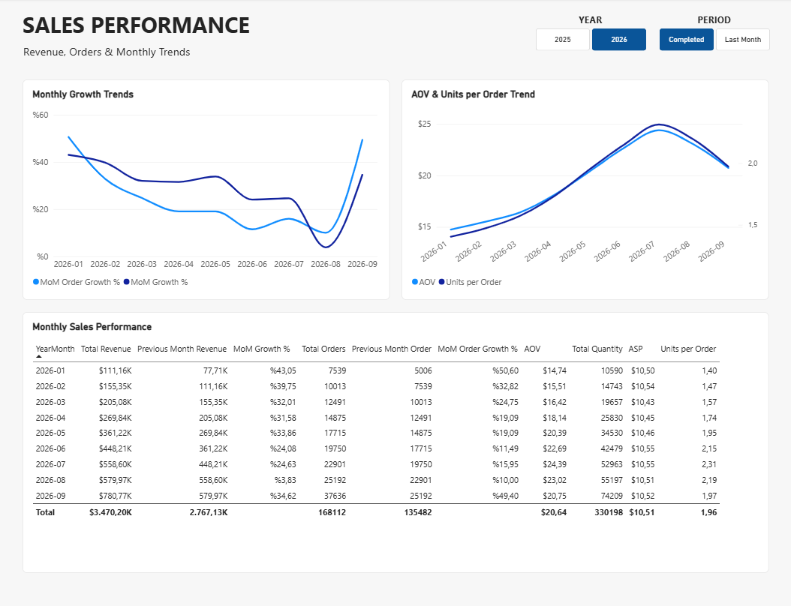
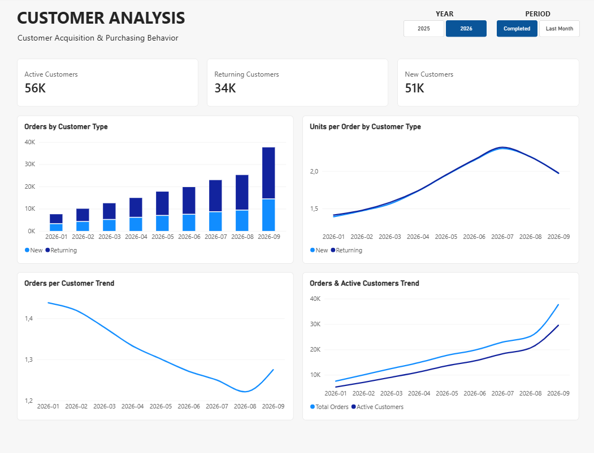
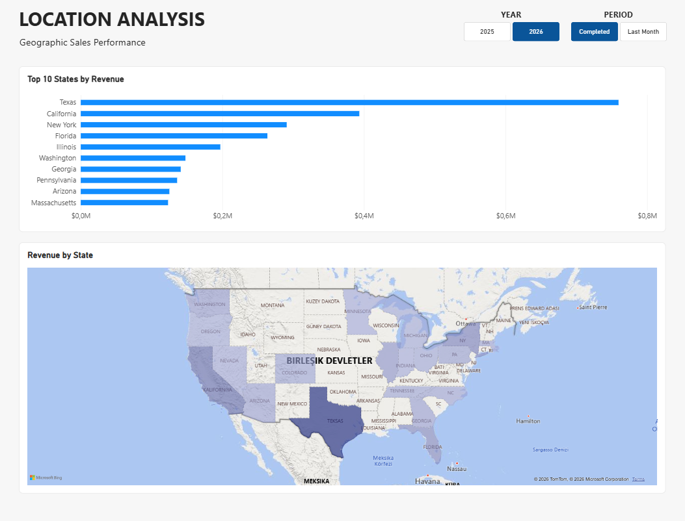
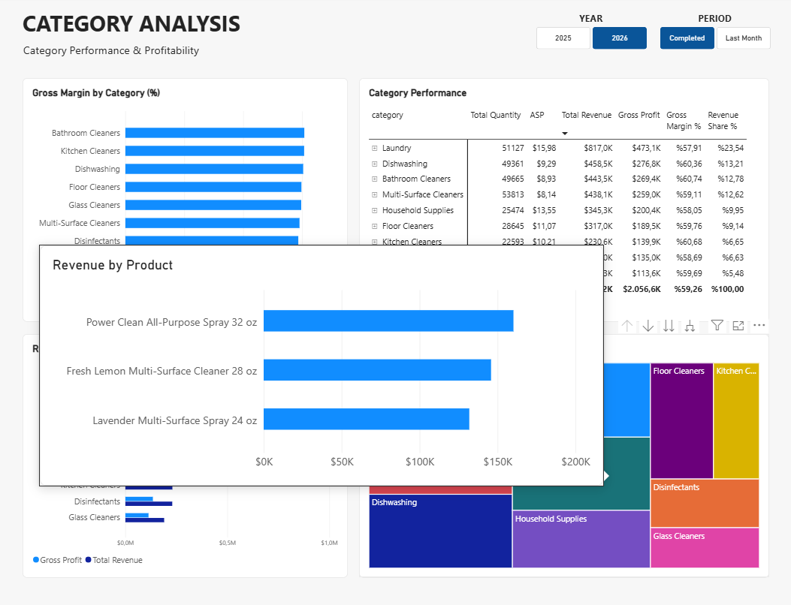
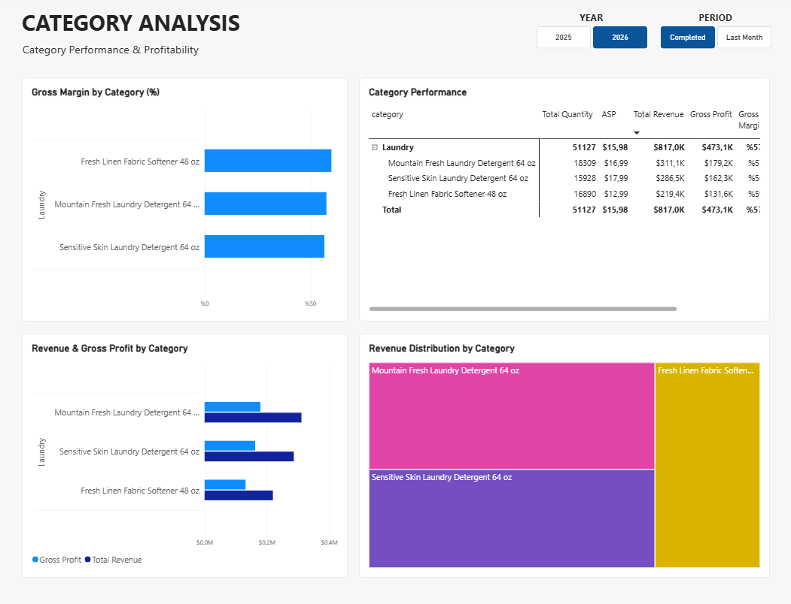
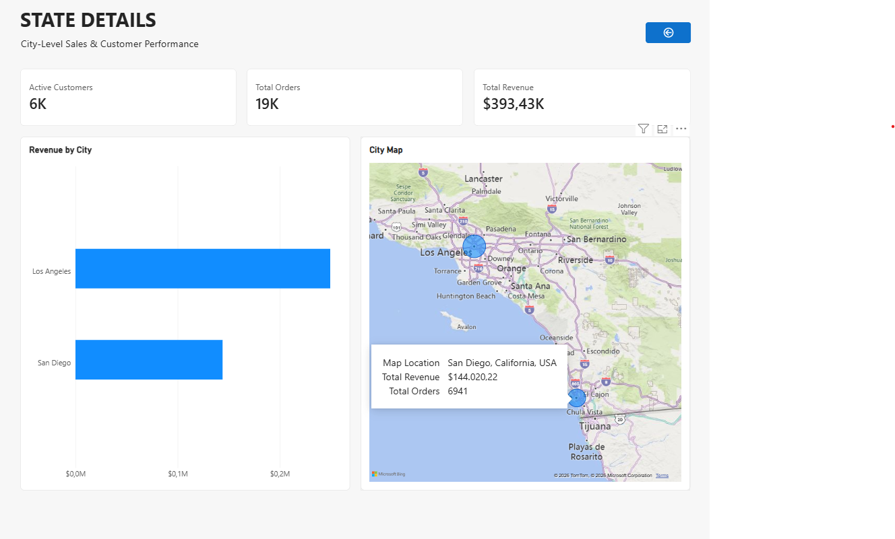

# Cleanity Data Pipeline & Power BI Analytics

An end-to-end data analytics practice project using Python, REST APIs, Microsoft SQL Server, and Power BI.

## Project Overview

This project was developed to practice Power BI, data modeling, DAX, and interactive dashboard development using a synthetic e-commerce dataset.

The data is generated by a separate project, **[Cleanity Data Generator](https://github.com/MemduhCatalkaya/cleanity_data_generator)**, which simulates historical and continuously generated e-commerce transactions.

A Python pipeline retrieves data from the generator's REST API and loads it into Microsoft SQL Server. Power BI connects to the database to create an analytical data model and interactive reports.

The main focus is learning and demonstrating the technical workflow from data ingestion to business intelligence reporting.

## Architecture

```text
Cleanity Data Generator
(Python / FastAPI / SQLite)
          |
          | REST API / JSON
          v
Python Data Pipeline
(Requests / Incremental Sync)
          |
          v
Microsoft SQL Server
(Customers / Products / Orders)
          |
          v
Power BI Desktop
(Data Modeling / DAX)
          |
          v
Interactive Analytics Report
```

### Data Source

All transactional data originates from **Cleanity Data Generator**, a separate Python project designed to produce synthetic e-commerce data.

It provides historical data and generates additional customers and orders over time, exposing the records through REST API endpoints.

**Source repository:** [Cleanity Data Generator](https://github.com/MemduhCatalkaya/cleanity_data_generator)

This repository focuses on data ingestion, SQL Server integration, and Power BI analytics rather than data generation.

## Technologies

| Technology | Purpose |
|---|---|
| Python | Data ingestion and synchronization |
| Requests | REST API communication |
| Microsoft SQL Server | Relational data storage |
| SQL | Database schema and data operations |
| Power BI Desktop | Data modeling and visualization |
| DAX | Analytical measures and calculations |
| Git & GitHub | Version control and project documentation |

## Python Data Pipeline

The pipeline retrieves data from three REST API endpoints:

- `/products`
- `/customers?after_id=`
- `/orders?after_id=`

### Incremental Synchronization

Rather than reloading all records, the pipeline retrieves only newly generated customers and orders.

For each synchronization cycle:

1. Read the highest existing customer and order IDs from SQL Server.
2. Request records with IDs greater than the stored values.
3. Insert new records into the corresponding tables.
4. Commit successful transactions.

Products are synchronized separately, with existing product IDs excluded from insertion.

### Execution Modes

The command-line interface supports:

- **Sync Once:** Execute one synchronization cycle.
- **Continuous Sync:** Check for new records every 10 seconds.
- **Status:** Display current database record counts.
- **Exit:** Stop the application.

### Error Handling and Logging

The pipeline includes:

- HTTP request timeouts and error propagation.
- SQL transaction rollback on failed operations.
- Database connection and cursor cleanup.
- Terminal and file-based logging.
- Exception tracebacks for troubleshooting.

Logs are stored locally in `logs/pipeline.log` and excluded from version control.

## Database Structure

The SQL Server database contains three main tables.

| Table | Description |
|---|---|
| `customers` | Customer identifiers, names, locations, and registration dates |
| `products` | Product identifiers, categories, costs, and prices |
| `orders` | Transaction records, quantities, prices, dates, and sales channels |

The `orders` table references both `customers` and `products` through foreign keys.

## Power BI Data Model

The Power BI report uses a dimensional model with:

- **Fact table:** Orders
- **Dimension tables:** Customers, Products, DimDate

Relationships connect the dimensions to the orders table.

A dedicated date table supports monthly analysis, calendar attributes, and time intelligence calculations.

### DAX Measures

Key measures include:

- Total Revenue
- Gross Profit
- Gross Margin %
- Total Orders
- Total Quantity
- Average Order Value (AOV)
- Average Selling Price (ASP)
- Revenue Share %
- Previous Month Revenue
- Month-over-Month Revenue Growth %
- Month-over-Month Order Growth %
- Active Customers
- New Customers
- Returning Customers
- Orders per Customer
- Units per Order

## Power BI Dashboard

The report contains five main analytical pages.

### 1. Executive Overview

An overview of revenue, profitability, order volume, average order value, and monthly performance.



### 2. Category Analysis

Product category performance, gross margins, revenue distribution, and product-level comparisons.



### 3. Sales Performance

Monthly revenue and order growth, average order value, average selling price, and detailed period comparisons.



### 4. Customer Analysis

Customer acquisition, returning customer activity, purchase frequency, and order behavior over time.



### 5. Location Analysis

Geographic revenue distribution and state-level sales performance.



## Interactive Features

The report includes synchronized year and period slicers, cross-filtering, drill-down, drill-through, and custom report page tooltips.

### Report Page Tooltip

Hovering over a category in the treemap displays a custom tooltip containing product-level revenue information.



### Product Drill-down

Category-level visuals can be expanded to inspect individual product performance.



### State Drill-through

Selecting a state opens a dedicated detail page with city-level revenue, customer metrics, and geographic visualization.



## Project Structure

```text
cleanity_data_pipeline/
├── src/
│   ├── api_client.py
│   ├── database.py
│   ├── main.py
│   └── sync.py
├── powerbi/
│   └── Cleanity_Analytics.pbix
├── screenshots/
│   ├── 01_executive_overview.png
│   ├── 02_category_analysis.png
│   ├── 03_sales_performance.png
│   ├── 04_customer_analysis.png
│   ├── 05_location_analysis.png
│   ├── 06_category_tooltip.png
│   ├── 07_category_drilldown.png
│   └── 08_state_drillthrough.png
├── .gitignore
├── requirements.txt
└── README.md
```

## Setup and Usage

### Requirements

- Python
- Microsoft SQL Server
- Power BI Desktop
- Running Cleanity Data Generator REST API

### Install Dependencies

```bash
python -m pip install -r requirements.txt
```

### Configure Database Connection

The pipeline uses Windows Authentication and connects to a local SQL Server instance by default.

Update the connection strings in `src/database.py` if your SQL Server configuration differs.

The database and required tables are created automatically if they do not already exist.

### Run the Pipeline

Start the Cleanity Data Generator API, then execute:

```bash
python src/main.py
```

Choose a synchronization mode from the command-line menu.

### Open the Power BI Report

Open:

`powerbi/Cleanity_Analytics.pbix`

The report was developed using Power BI Desktop and a local SQL Server database.

To refresh data in another environment, update the Power BI data source connection to the appropriate SQL Server instance.

## Notes

- All customer, product, and transaction data is synthetic.
- The project is intended for technical learning and portfolio demonstration.
- The Power BI report is designed for local use.
- Automatic cloud refresh and public Power BI Service hosting are not configured.

## Related Project

**Cleanity Data Generator** — Synthetic e-commerce data generation and REST API.

[View the Cleanity Data Generator repository](https://github.com/MemduhCatalkaya/cleanity_data_generator)
